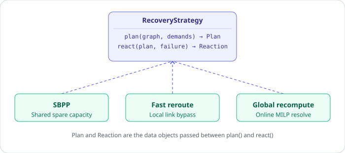

# net-restoration-bench

Benchmark comparing SDN link-failure recovery strategies — shared backup path
protection (SBPP), Fast Reroute and global MILP recomputation — on capacity
overhead, restoration rate, reaction time and path stretch. Proposal for the
*Discrete and Network Optimization Problems M* exam.

## Layout

```
src/net_restoration_bench/
  topology.py       random networks and traffic demands
  failure.py        single-link failure scenarios
  solvers/
    base.py          RecoveryStrategy interface (plan / react)
    sbpp.py           shared backup path protection
    fast_reroute.py   precomputed local bypass per link
    global_recompute.py  online MILP resolve, no reserved capacity
  metrics.py         capacity overhead, restoration rate, churn, path stretch
  benchmark.py       runs every strategy over the same scenarios
  plotting.py        overhead/restoration/solver-time/churn figures, topology view
tests/
```

Every strategy implements the same `plan(graph, demands)` /
`react(graph, plan, failure)` interface, so `benchmark.run` can score all
three on identical topologies and failure scenarios.



## Setup

```bash
python3 -m venv .venv
.venv/bin/pip install -e '.[dev]'
.venv/bin/pytest
```
